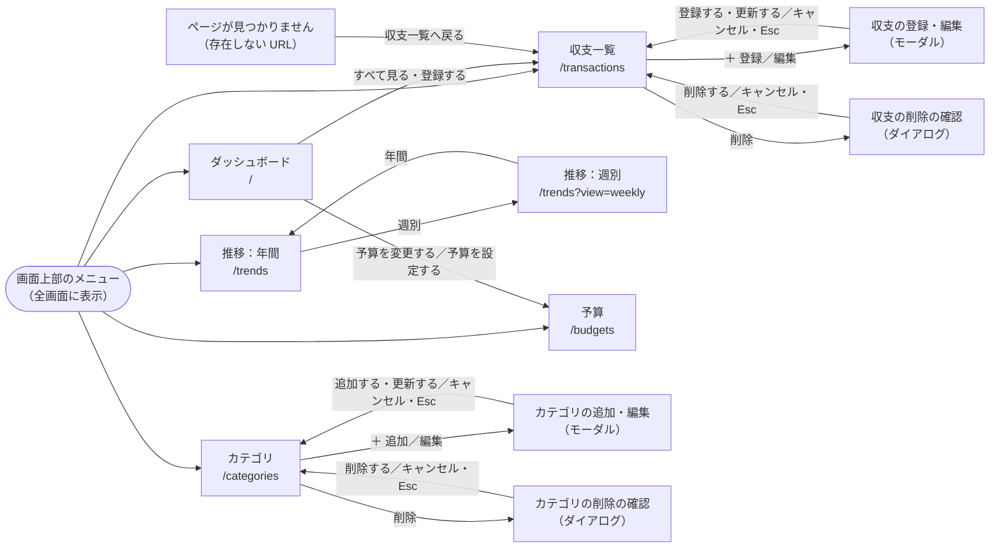
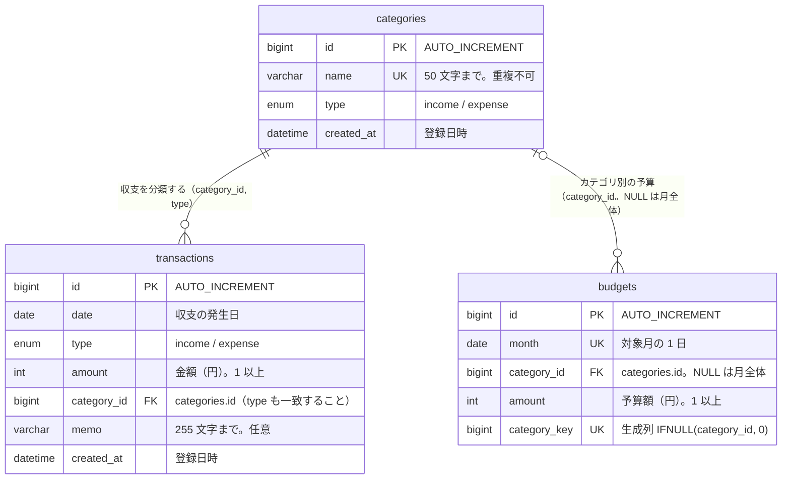

# school-kakeibo

収入・支出を記録し、月別・週別の推移、カテゴリ別の内訳、予算の使用状況をひと目で確認できる家計簿アプリです。1人で使うことを想定し、自分のパソコンで開発して、AWS には自分のパソコンからだけ開けるように置いています。要件は [docs/requirements.md](docs/requirements.md) にまとめています。

## デモ動画

実際の操作の動画です。操作に合わせて、要件定義書のどの機能（F-01〜F-14）かをテロップで示しています。

**[▶ 動画を見る（約 3 分、docs/images/demo.mp4）](docs/images/demo.mp4)**

F-01〜F-14 のすべての機能を順に紹介しています。

### 削除の確認ダイアログ

収支やカテゴリを削除するときは、画面内に確認ダイアログが出ます。「削除する」で削除され、「キャンセル」や Esc キーでは削除されません。

| 収支の削除 | カテゴリの削除 |
|---|---|
|  |  |

## 機能

| ID | 機能 | 内容 |
|---|---|---|
| F-01 | 収支の登録 | 日付・種別（収入/支出）・金額・カテゴリ・メモを登録。カテゴリは前回登録したものが最初から入る |
| F-02 | 収支の一覧 | 月ごとに新しい順で表示 |
| F-03 | 収支の編集・削除 | 削除の前に、画面内に確認ダイアログを出す |
| F-04 | 月次サマリー | 当月の収入合計・支出合計・差額（差額はプラスなら緑、マイナスなら赤） |
| F-05 | カテゴリ別集計 | 支出のカテゴリ別の内訳を円グラフと一覧で表示 |
| F-06 | 月の切り替え | 前月・翌月へ移動（今年の前後 10 年まで） |
| F-07 | カテゴリの管理 | カテゴリの追加・編集・削除（使用中のカテゴリは削除できない） |
| F-08 | 予算設定 | 月ごとに、支出カテゴリ別の予算を設定。月全体の予算はカテゴリ別の合計が自動で入る。金額には入力中に 3 桁ごとのカンマが付く。前月の予算を入力欄に入れられる |
| F-09 | 予算超過の警告 | 予算の 80% 以上で「注意」、100% を超えたら「超過」をダッシュボードに表示。使用率をバーで表示 |
| F-10 | 絞り込み | 収支一覧をキーワード（メモ）・カテゴリ・種別で絞り込む。キーワードは入力中に反映 |
| F-11 | 月別推移グラフ | 1 年分の月ごとの収入・支出（棒）と差額（折れ線） |
| F-12 | 週別推移 | 直近 12 週（月曜始まり）の収入・支出を、カテゴリ別の内訳つきの表で表示 |
| F-13 | カテゴリ別推移 | カテゴリを選んで、そのカテゴリだけの月別の推移を表示 |
| F-14 | カテゴリ×月の支出表 | 1 年分の支出を、縦がカテゴリ・横が月の表で一覧（金額が大きいほど濃い色） |

ほかに、OS の設定に合わせたダークモード、スマホ幅（375px〜）での表示、データを読み込めなかったときの原因つきのエラー表示に対応しています。

## 設計

くわしくは [要件定義書](docs/requirements.md) にまとめています。

| 資料 | 場所 |
|---|---|
| 画面一覧・画面遷移図 | [要件定義書「5. 画面一覧」](docs/requirements.md#5-画面一覧) |
| DB 設計（ER 図・テーブル定義・制約・CRUD 表・環境） | [要件定義書「6. データ設計」](docs/requirements.md#6-データ設計) |
| API 仕様（画面の URL と Server Actions） | [要件定義書「7. API 仕様」](docs/requirements.md#7-api-仕様) |

### 画面遷移図



### ER 図



### API の一覧

外部に公開する REST API はありません。画面の表示はページの URL（GET）、データの登録・更新・削除は Next.js の Server Actions で行います。

| 種類 | API | 内容 |
|---|---|---|
| 画面 | `GET /?month=YYYY-MM` | ダッシュボード |
| 画面 | `GET /transactions?month=&q=&type=&category=` | 収支一覧（絞り込みつき） |
| 画面 | `GET /trends?view=yearly|weekly&year=&category=` | 推移（年間・週別） |
| 画面 | `GET /budgets?month=YYYY-MM` | 予算の入力 |
| 画面 | `GET /categories` | カテゴリの一覧 |
| Server Action | `createTransactionAction` / `updateTransactionAction` / `deleteTransactionAction` | 収支の登録・更新・削除 |
| Server Action | `createCategoryAction` / `updateCategoryAction` / `deleteCategoryAction` | カテゴリの追加・名前の変更・削除 |
| Server Action | `saveBudgetsAction` | 1 か月分の予算の保存（月全体はカテゴリ別の合計） |

入力の検証・処理・戻り値・エラーは、[要件定義書「7. API 仕様」](docs/requirements.md#7-api-仕様) にあります。

## 使用技術

| 領域 | 技術 |
|---|---|
| フロントエンド | Next.js 16 (App Router) / React 19 / TypeScript 6 |
| スタイル | Tailwind CSS 4 |
| データベース | MySQL 9.7（LTS。ローカルは Docker）/ AWS では RDS for MySQL 8.4（LTS） |
| DB アクセス | mysql2 |
| グラフ | Recharts |
| テスト | Vitest |
| 実行環境 | Node.js 26（LTS）、Docker |
| インフラ | AWS（EC2 + RDS for MySQL、無料枠の範囲）/ Terraform |

認証がないため、だれでも開ける場所には置いていません。ローカルでは、開発サーバー（3000）と MySQL（3306）は、このパソコン（127.0.0.1）からの接続だけを受け付けます。AWS では、自分のパソコンのグローバル IP からだけアプリに接続できるようにしています（SSH は開けず、DB は外から接続できません）。

## AWS へのデプロイ

Terraform（`infra/`）で EC2・RDS などを作り、Docker イメージを EC2 で動かします。手順は [docs/deploy.md](docs/deploy.md) にまとめています。

## セットアップ

必要なもの: Node.js 26（LTS）以上、Docker（Docker Desktop）

1. 依存パッケージをインストールする

   ```sh
   npm install
   ```

2. MySQL を起動する（初回はイメージのダウンロードに時間がかかります）

   ```sh
   docker compose up -d
   ```

3. 開発サーバーを起動し、http://localhost:3000 を開く。ダッシュボード（今月の収入・支出など）が表示されれば成功

   ```sh
   npm run dev
   ```

初回の起動時に、`db/init/` の SQL でテーブル・初期カテゴリ・サンプルデータ（直近約5か月分）が自動で作られます。データを最初の状態に戻したいときは、`docker compose down -v` のあとにもう一度 `docker compose up -d` を実行します。

接続先を変えたいときは、`.env.example` を `.env.local` にコピーして値を書き換えます（デフォルトは `docker-compose.yml` と同じ値なので、通常は不要です）。

### MySQL 8.4 から 9.7 への移行（以前のデータが残っている場合）

MySQL は 9.7（LTS）を使います。8.4 で作ったデータは、9.7 で起動したときに自動で移行されます（初回の起動は数十秒かかります）。**9.7 に移行したデータは 8.4 では使えなくなる**ので、先にバックアップを取ってください。

```sh
# 1. バックアップ（8.4 で動いている状態で実行。backup.sql は Git に含めない）
docker compose exec db sh -c "mysqldump -uroot -proot --single-transaction --no-tablespaces --set-gtid-purged=OFF kakeibo > /tmp/backup.sql"
docker compose cp db:/tmp/backup.sql ./backup.sql

# 2. 9.7 で起動し直す（コンテナが作り直され、データが移行される）
docker compose up -d
```

元に戻したいときは、`docker compose down -v` でデータを消してから起動し直し、バックアップを読み込みます（8.4 に戻すときは、先に `docker-compose.yml` のイメージを `mysql:8.4` にします）。

```sh
docker compose cp ./backup.sql db:/tmp/backup.sql
docker compose exec db sh -c "mysql -uroot -proot kakeibo < /tmp/backup.sql"
```

- バックアップと読み込みは管理者（root）で行います。MySQL 9.7 の `mysqldump` は、アプリ用のユーザー（kakeibo）にない権限を必要とするためです。パスワードは `docker-compose.yml` の開発用の値です。
- バックアップは、Windows の PowerShell の `>` で直接ファイルに書き出さないでください（文字コードが UTF-16 になり、読み込めなくなります）。上のように、コンテナの中で作ってからコピーします。

## コマンド

| コマンド | 内容 |
|---|---|
| `npm run dev` | 開発サーバーを起動 |
| `npm run build` | 本番ビルド |
| `npm run lint` | ESLint を実行 |
| `npm test` | 自動テスト（Vitest）を実行 |
| `docker compose up -d` | MySQL を起動 |
| `docker compose down` | MySQL を停止（データは残る） |
| `docker compose down -v` | MySQL を停止し、データも削除 |
