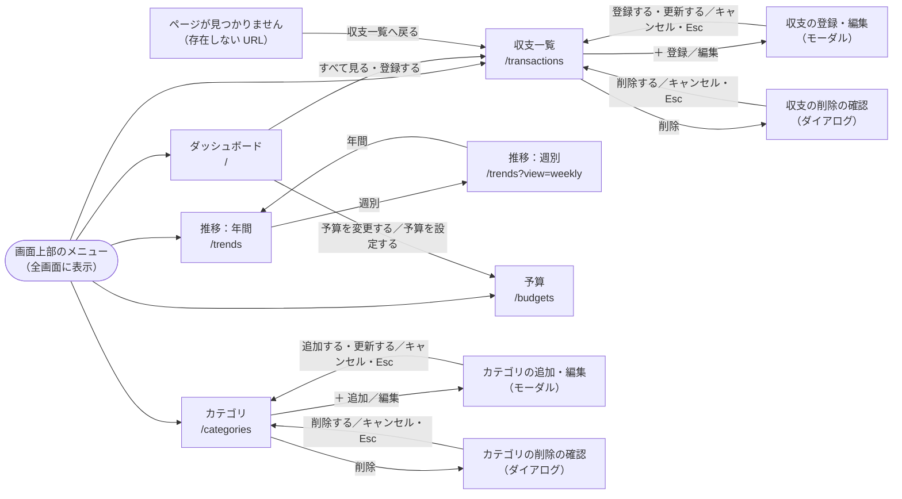
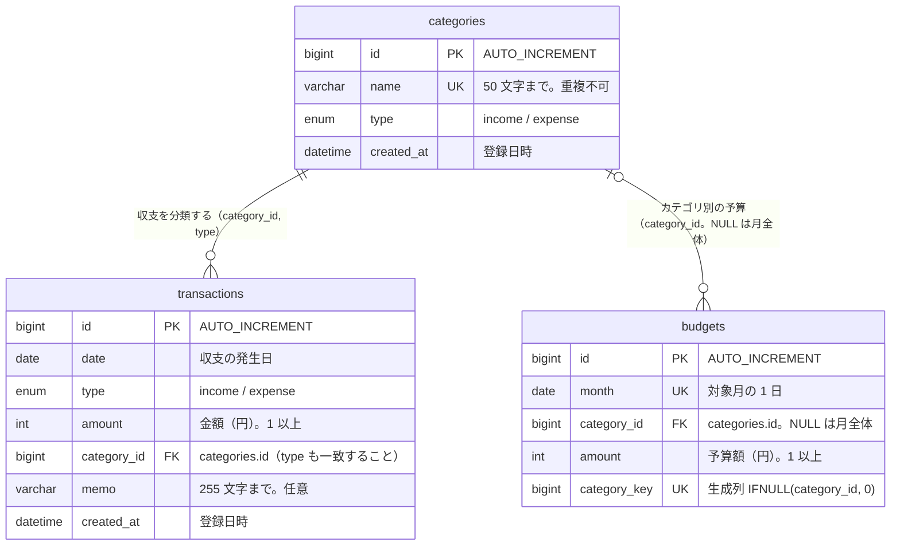

# 家計簿アプリ 要件定義書

| 項目 | 内容 |
|---|---|
| 作成日 | 2026-11-03 |
| 状態 | 第7版（2026-11-12）。必須機能 F-01〜F-14 を実装済み。AWS へのデプロイ（このPCの IP だけ許可）を追加。月全体の予算をカテゴリ別の合計から自動で決めるよう変更（#53）。画面遷移図（5.1）、DB 設計（6.1〜6.5）、API 仕様（7）を追加（#55） |
| 成果物の見せ方 | GitHub の README に、実際の操作の動画（機能を示すテロップつき）を載せる。確認ダイアログは画像でも示す |

## 1. 目的
日々の収入・支出を記録し、月ごと・週ごとの収支、カテゴリ別の内訳、推移、予算に対する使用状況が一目で分かる Web アプリを作る。
設計 → 実装 → 公開までを一通り経験し、成果を README の動画で示せる状態にする。

## 2. 対象ユーザー
- 自分の収支を手軽に把握したい個人（開発者本人が使う）
- スマホ（外出先での入力）とPC（月末の振り返り）の両方で使う

## 3. 技術スタック
バージョンは、安定版（正式リリース）の中で最新を使う。長期サポート版（LTS）があるものは、LTS の最新を使う。ほかの部品がまだ対応していないものは、動く範囲で最新にし、理由を備考に書く（2026年11月時点）。

| 領域 | 採用 | 備考 |
|---|---|---|
| フロントエンド | Next.js 16 (App Router) + React 19 | |
| 言語 | TypeScript 6.0 | 7.0 は、lint で使う typescript-eslint が対応していない（6.1 未満まで）ため、6.0 系の最新を使う |
| スタイル | Tailwind CSS 4 | |
| データベース | MySQL 9.7（LTS）、AWS では RDS for MySQL 8.4（LTS） | ローカルは Docker で起動する（`docker-compose.yml`）。LTS（長期サポート版）の最新を使う。RDS は 9 系に対応していない（2026年11月時点で使えるのは 8.4 系まで）ため、AWS では RDS で使える LTS の最新（8.4 系）を使う。アプリの SQL は 8.4 でも動く |
| DB アクセス | mysql2 3（SQL を直接書く） | Next.js のサーバー側（Server Components / Server Actions）から利用 |
| グラフ | Recharts 3 | |
| テスト | Vitest 5 | 計算・検証の処理の自動テスト |
| lint | ESLint 9 | 10 は、Next.js の lint 設定（eslint-config-next）が使う eslint-plugin-react / import / jsx-a11y が対応していないため、9 系の最新を使う |
| 実行環境 | Node.js 26（LTS） | 開発はローカル。本番は Docker イメージ（`Dockerfile`、Next.js の standalone 出力） |
| インフラ | AWS（EC2 t3.micro + RDS for MySQL db.t4g.micro、ECR、SSM Parameter Store）、東京リージョン | 無料枠の範囲で動かす。ALB・NAT Gateway など有料のものは使わない。手順は [deploy.md](deploy.md) |
| IaC | Terraform（`infra/`） | state はローカルに置き、Git に含めない（パスワードが入るため） |

- ログイン（認証）機能は作らない。1人専用のアプリとする（4.3 参照）。
- 前のアプリ（PostgreSQL）とは別の種類のデータベースを使う。

## 4. スコープ
### 4.1 必須
| ID | 機能 | 概要 |
|---|---|---|
| F-01 | 収支の登録 | 日付・種別(収入/支出)・金額・カテゴリ・メモ |
| F-02 | 収支の一覧 | 月単位で表示。新しい順 |
| F-03 | 収支の編集・削除 | 削除の前に、アプリの画面内に確認ダイアログを出す（「削除する」で削除、「キャンセル」・Esc で中止）。カテゴリの削除（F-07）も同じ |
| F-04 | 月次サマリー | 当月の収入合計・支出合計・差額 |
| F-05 | カテゴリ別集計 | 支出のカテゴリ別内訳を円グラフで表示 |
| F-06 | 月の切り替え | 前月/翌月へ移動。表示できるのは今年の前後10年（1980〜2050年の範囲内）。範囲外や不正な年月が指定されたときは今月を表示する |
| F-07 | カテゴリの管理 | 初期カテゴリ(食費・日用品・交通費・住居・娯楽・給与 など)に加え、カテゴリの追加・編集・削除ができる |
| F-08 | 予算設定 | 月ごとに支出カテゴリ別の予算を設定する。月全体の予算は入力せず、カテゴリ別の予算の合計を自動で表示・保存する（入力するたびにその場で合計が変わる。カテゴリ別がすべて空欄なら月全体も予算なし）。金額の入力欄には、入力中に 3 桁ごとのカンマを自動で付ける。前月の予算を入力欄に入れられる |
| F-09 | 予算超過の警告 | 使用額が予算の80%以上（100%ちょうどを含む）で注意、100%超で警告をダッシュボードに表示。使用率をバーで表示 |
| F-10 | 絞り込み | 収支一覧をキーワード（メモ）・カテゴリ・種別で絞り込む |
| F-11 | 月別推移グラフ | 月ごとの収入・支出・差額の推移を棒/折れ線で表示（選択した年の1〜12月。前年/翌年へ切り替えられる。表示できる年は F-06 と同じ範囲） |
| F-12 | 週別推移 | 週ごとの収入・支出・差額を、収入・支出それぞれのカテゴリ別の内訳つきの表で表示（直近12週）。週は月曜始まり |
| F-13 | カテゴリ別推移 | F-11 の月別グラフを、カテゴリを選んで見られる（選択したカテゴリだけの月別推移）。週別は F-12 の表でカテゴリ別に見られる |
| F-14 | カテゴリ×月の支出表 | 選択した年の支出を、縦がカテゴリ・横が月の表で一覧する。金額が大きいほどマスの色を濃くし、カテゴリ別・月別の合計も出す |

### 4.2 あれば良い（時間があれば）
- CSV エクスポート（未実装）
- ダークモード（実装済み。OS の設定に合わせて自動で切り替わる）

### 4.3 対象外
- ログイン・会員登録などの認証機能（今回は作らない）
- 複数人での利用・共有
- 銀行・クレジットカードとの連携、レシート読み取り
- 外貨、ネイティブアプリ化

## 5. 画面一覧
| 画面 | パス | 内容 |
|---|---|---|
| ダッシュボード | `/` | 月次サマリー、カテゴリ別円グラフ、予算の使用状況と警告、直近の収支 (F-04, F-05, F-06, F-09) |
| 収支一覧 | `/transactions` | 月別一覧、絞り込み、編集・削除 (F-02, F-03, F-06, F-10) |
| 収支の登録/編集 | `/transactions` 上のモーダル（ポップアップ） | F-01, F-03 |
| 推移 | `/trends` | 「年間 / 週別」を切り替える。年間: 年の切り替え、月別の収支グラフ、カテゴリ×月の支出表。週別: 直近12週の収入・支出（カテゴリ別の内訳つき）と差額の表。カテゴリ選択 (F-11, F-12, F-13, F-14) |
| 予算 | `/budgets` | 月ごとの予算の設定 (F-08) |
| カテゴリ管理 | `/categories` | 追加・編集・削除 (F-07) |

### 5.1 画面遷移図
画面上部のメニュー（ダッシュボード・収支一覧・推移・予算・カテゴリ）は全画面に表示され、どの画面からでも移動できる。モーダルと確認ダイアログは、URL を変えずに画面の上に開く。

同じ画面の中での移動（URL のパラメータだけが変わる）:

| 画面 | 操作 | 移動先 |
|---|---|---|
| ダッシュボード・収支一覧・予算 | 「← 前月」「翌月 →」 | 同じ画面の前月・翌月（`?month=YYYY-MM`）。表示できる範囲の端では押せない |
| 収支一覧 | 絞り込み（キーワード・種別・カテゴリ） | 同じ画面（`?q=&type=&category=` を付ける。ブラウザの履歴は増やさない） |
| 推移（年間） | 「← 前年」「翌年 →」、カテゴリの選択 | 同じ画面（`?year=YYYY&category=<id>`） |
| 予算 | 「〇月の予算を入れる」 | 同じ画面のまま、入力欄に前月の予算を入れる（保存はしない） |
| すべての画面 | データを読み込めなかったとき | 同じ画面の上部にエラーと原因を表示（「もう一度読み込む」で読み込み直す） |

## 6. データ設計
MySQL に作成する（文字コードは utf8mb4）。認証を使わないため、ユーザーを表す列は持たない。ローカルは Docker の MySQL、AWS は RDS for MySQL（6.5 参照）。

### 6.1 ER 図

- `categories` 1 件に対して、`transactions` と `budgets` は 0 件以上。
- `transactions` は必ず 1 つのカテゴリに属し、収支の種別とカテゴリの種別が一致しなければならない。
- `budgets` は月全体の予算（`category_id` が NULL）か、支出カテゴリ 1 つの予算。

### 6.2 テーブル定義

**categories**
| 列 | 型 | 説明 |
|---|---|---|
| id | BIGINT UNSIGNED (PK, AUTO_INCREMENT) | |
| name | VARCHAR(50) | カテゴリ名（重複不可） |
| type | ENUM('income','expense') | |
| created_at | DATETIME | |

**transactions**
| 列 | 型 | 説明 |
|---|---|---|
| id | BIGINT UNSIGNED (PK, AUTO_INCREMENT) | |
| date | DATE | 収支の発生日 |
| type | ENUM('income','expense') | |
| amount | INT UNSIGNED | 金額(円)。1 以上 |
| category_id | BIGINT UNSIGNED (FK → categories) | 使用中のカテゴリは削除不可 |
| memo | VARCHAR(255) | 任意 |
| created_at | DATETIME | |

**budgets**
| 列 | 型 | 説明 |
|---|---|---|
| id | BIGINT UNSIGNED (PK, AUTO_INCREMENT) | |
| month | DATE | 対象月の1日（例: 2026-11-01） |
| category_id | BIGINT UNSIGNED (FK → categories, null 可) | null は月全体の予算 |
| amount | INT UNSIGNED | 予算額(円)。1 以上。月全体の予算は、保存時にアプリがカテゴリ別の合計を入れる |

- 月 + カテゴリの組み合わせは一意にする。月全体の予算（category_id が null）も重複しないよう、null を 0 に置き換えた生成列 `category_key` に一意制約を付けている。
- `budgets.month` は必ず1日（CHECK 制約）。
- 収支の種別とカテゴリの種別が一致しない行は、複合外部キー `(category_id, type)` により DB が拒否する。
- 使用中のカテゴリ（収支・予算で使われているもの）は DB が削除を拒否する。アプリ側で、使用中の場合は分かりやすいメッセージを出す。
- 実際の定義は [db/init/01_schema.sql](../db/init/01_schema.sql)。初期カテゴリは `02_categories.sql`、サンプルデータは `03_sample_data.sql`。
- 金額は円単位の整数で保持する（小数誤差を避ける）。種別(type)で収入/支出を表すため、amount は常に正の値。
- 集計（月別・週別・カテゴリ別）は、SQL の集計クエリ（GROUP BY）で行う。週は月曜始まりで、その週の月曜日の日付（`DATE_SUB(date, INTERVAL WEEKDAY(date) DAY)`）ごとに集計する。`WEEK()` の週番号と違い、年をまたぐ週も 1 週として集計できる。
- テーブルは SQL ファイルで管理し、Docker の初回起動時に自動で作成する（AWS の作り方は 6.5 参照）。

### 6.3 制約・インデックス
| テーブル | 名前 | 種類 | 対象の列 | 目的 |
|---|---|---|---|---|
| categories | PRIMARY | 主キー | id | |
| categories | uq_categories_name | 一意 | name | 同じ名前のカテゴリを作らせない |
| categories | uq_categories_id_type | 一意 | (id, type) | transactions の複合外部キーの参照先 |
| transactions | PRIMARY | 主キー | id | |
| transactions | idx_transactions_date | インデックス | date | 月・年・週の期間で絞り込む集計を速くする |
| transactions | idx_transactions_category_date | インデックス | (category_id, date) | カテゴリ別の推移（F-13）を速くする |
| transactions | chk_transactions_amount | CHECK | amount | 金額は 1 以上 |
| transactions | fk_transactions_category | 外部キー | (category_id, type) → categories (id, type) | 存在しないカテゴリと、種別が違うカテゴリを拒否する。使用中のカテゴリは削除できない（RESTRICT） |
| budgets | PRIMARY | 主キー | id | |
| budgets | uq_budgets_month_category | 一意 | (month, category_key) | 同じ月・同じカテゴリの予算を 1 件にする（月全体の予算も 1 件） |
| budgets | chk_budgets_amount | CHECK | amount | 予算額は 1 以上 |
| budgets | chk_budgets_month | CHECK | month | 月は必ず 1 日 |
| budgets | fk_budgets_category | 外部キー | category_id → categories (id) | 存在しないカテゴリを拒否する。予算で使っているカテゴリは削除できない（RESTRICT） |

### 6.4 画面ごとに使うテーブル（CRUD）
C: 登録、R: 読み取り、U: 更新、D: 削除。

| 画面 | categories | transactions | budgets |
|---|---|---|---|
| ダッシュボード（`/`） | R | R（月の合計、カテゴリ別、直近の収支） | R（予算の使用状況） |
| 収支一覧（`/transactions`） | R（選択肢） | C R U D | |
| 推移（`/trends`） | R（選択肢） | R（月別・週別・カテゴリ別の集計） | |
| 予算（`/budgets`） | R（支出カテゴリ） | R（月のカテゴリ別の支出） | R C U D（保存時に一括） |
| カテゴリ（`/categories`） | C R U D | R（使用件数） | R（使用件数） |

### 6.5 DB の環境と初期化
| 環境 | DB | 接続 | テーブルの作り方 |
|---|---|---|---|
| ローカル（開発） | Docker の MySQL 9.7（`docker-compose.yml`） | 127.0.0.1:3306 だけで待ち受ける。接続情報は `.env.example` の値（変えるときは `.env.local`） | 空のデータボリュームで初回起動したとき、`db/init/*.sql` をファイル名の順に自動で実行する |
| AWS（本番） | RDS for MySQL 8.4（db.t4g.micro） | private subnet に置き、EC2 からだけ接続できる。パスワードは SSM Parameter Store から読む | デプロイ後に 1 回だけ `node scripts/db-init.mjs` を実行する（テーブルがあるときは何もしない） |

- アプリは `src/lib/db/pool.ts` の接続プール（mysql2、最大 5 接続）から、サーバー側のコードでだけ DB を使う。ブラウザから DB には接続しない。
- 予算の保存（複数行の登録・更新・削除）は 1 つのトランザクションで行い、途中で失敗したら全部取り消す。

## 7. API 仕様
外部に公開する REST API は作らない。画面の表示は **ページの URL（GET）**、データの登録・更新・削除は Next.js の **Server Actions** で行う。Server Actions は、画面のフォームから Next.js が自動で作る POST リクエストで呼ばれる関数で、アプリの外から使うことは想定しない。

共通のきまり:
- 認証はない（1 人専用。接続できる場所を IP で制限する。「8. 非機能要件」を参照）。
- 金額は円単位の整数。月は `YYYY-MM`、年は `YYYY`、日付は `YYYY-MM-DD`。
- 入力の検証はサーバー側で行い、エラーは日本語で返す（DB の CHECK 制約・外部キーでも検証する）。
- SQL はすべてプレースホルダ（`?`）で実行する。
- 保存に成功したら、関係する画面のキャッシュを捨て（`revalidatePath`）、次の表示で新しいデータを読む。

### 7.1 画面（GET）
| パス | パラメータ | 内容 |
|---|---|---|
| `/` | `month`（`YYYY-MM`） | 指定した月のダッシュボード。サマリー、予算の使用状況と警告、カテゴリ別の支出、直近の収支 |
| `/transactions` | `month`、`q`（メモのキーワード、100 文字まで）、`type`（`income` / `expense`）、`category`（カテゴリ ID） | 指定した月の収支の一覧（新しい順）。`q`・`type`・`category` で絞り込む |
| `/trends` | `view`（`yearly` / `weekly`）、`year`（`YYYY`）、`category`（カテゴリ ID） | `yearly`: その年の月別の収支グラフとカテゴリ×月の支出表。`category` を付けるとそのカテゴリだけの月別推移。`weekly`: 直近 12 週の週別の表 |
| `/budgets` | `month`（`YYYY-MM`） | 指定した月の予算の入力画面 |
| `/categories` | なし | カテゴリの一覧（収支・予算での使用件数つき） |

- パラメータを省略したときや不正な値のときは、エラーにせず既定の値で表示する。`month` は今月、`year` は今年、`view` は `yearly`、`q`・`type`・`category` は「指定なし」。
- 表示できる月・年は、今年の前後 10 年（1980〜2050 年の範囲内）。範囲外は今月・今年として扱う。
- 存在しない URL は「ページが見つかりません」（HTTP 404）。DB に接続できないなどで読み込めないときは、画面の上部にエラーの種類・内容・対処を表示する。

### 7.2 Server Actions（登録・更新・削除）
| 関数 | ファイル | 引数 | 戻り値 |
|---|---|---|---|
| `createTransactionAction` | `src/app/transactions/actions.ts` | `formData` | `TransactionFormState` |
| `updateTransactionAction` | 同上 | `id`, `formData` | `TransactionFormState` |
| `deleteTransactionAction` | 同上 | `id` | なし |
| `createCategoryAction` | `src/app/categories/actions.ts` | `formData` | `CategoryFormState` |
| `updateCategoryAction` | 同上 | `id`, `formData` | `CategoryFormState` |
| `deleteCategoryAction` | 同上 | `id` | `{ error?: string }` |
| `saveBudgetsAction` | `src/app/budgets/actions.ts` | `month`, `formData` | `BudgetFormState` |

戻り値の型は `src/lib/types.ts` にある。成功したときと、エラーがあったときで中身が変わる。

| 型 | 成功したとき | エラーのとき |
|---|---|---|
| `TransactionFormState` | `{ savedMonth: "YYYY-MM" }`（保存した収支の月。画面はその月の一覧を表示する） | `{ errors: { 項目名: メッセージ }, values: 入力値 }`（入力値を残して画面に戻す） |
| `CategoryFormState` | `{ saved: true }` | `{ errors: { 項目名: メッセージ } }` |
| `BudgetFormState` | `{ saved: true }` | `{ errors: { 入力欄の name: メッセージ } }` |

`errors` のキーは入力欄の名前。画面全体に出すエラーは `form` に入る。

#### 収支の登録・更新（`createTransactionAction` / `updateTransactionAction`）
| 入力（`formData`） | 必須 | 検証 |
|---|---|---|
| `date` | ○ | `YYYY-MM-DD` の実在する日付 |
| `type` | ○ | `income` か `expense` |
| `amount` | ○ | 半角の整数、1〜99,999,999 |
| `categoryId` | ○ | 1 以上の整数。種別と合うカテゴリ（DB の外部キーで確認） |
| `memo` | | 255 文字まで。空欄は NULL |

- 処理: 登録は `transactions` に INSERT、更新は `id` の行を UPDATE する。
- エラー: 検証エラー（各項目）／種別に合わないカテゴリ（`categoryId`: 「選んだ種別に合わないカテゴリです。選び直してください」）／更新対象が無い（`form`: 「この収支は既に削除されています」）／その他（`form`: 「保存に失敗しました。もう一度お試しください」）。

#### 収支の削除（`deleteTransactionAction`）
- 入力: `id`（1 以上の整数。それ以外は何もしない）。
- 処理: `transactions` から `id` の行を DELETE する。対象が無くてもエラーにしない。画面は、削除の前に確認ダイアログを出す。

#### カテゴリの追加・名前の変更（`createCategoryAction` / `updateCategoryAction`）
| 入力（`formData`） | 必須 | 検証 |
|---|---|---|
| `name` | ○ | 前後の空白（全角を含む）を除いて 1〜50 文字。ほかのカテゴリと重複しない（DB の一意制約で確認） |
| `type` | 追加のときだけ ○ | `income` か `expense`。変更では使わない（既存の収支と矛盾しないよう、種別は変えられない） |

- 処理: 追加は `categories` に INSERT、変更は `id` の行の `name` だけを UPDATE する。
- エラー: 検証エラー／同じ名前がある（`name`: 「同じ名前のカテゴリが既にあります」）／変更対象が無い（`form`: 「このカテゴリは既に削除されています」）／その他（`form`）。

#### カテゴリの削除（`deleteCategoryAction`）
- 入力: `id`（1 以上の整数。それ以外は何もしない）。
- 処理: `categories` から `id` の行を DELETE する。画面は、削除の前に確認ダイアログを出す。
- エラー: 収支・予算で使われている（DB の外部キーが拒否する）→ `{ error: "このカテゴリは収支または予算で使われているため、削除できません" }`／その他 →「削除に失敗しました。もう一度お試しください」。

#### 予算の保存（`saveBudgetsAction`）
| 入力 | 必須 | 検証 |
|---|---|---|
| `month`（引数） | ○ | `YYYY-MM`、表示できる範囲の月 |
| `category-<カテゴリ ID>`（`formData`、支出カテゴリごと） | | 空欄は予算なし。数字（全角・カンマ・「円」・「¥」は可）、1〜99,999,999 |

- 月全体の予算は入力として受け取らない。支出カテゴリ別の予算の合計を、サーバーで計算して保存する（すべて空欄なら月全体も予算なし）。合計が 99,999,999 を超えるとエラー（`total`）。
- 処理: 対象のカテゴリは DB から読む（収支カテゴリや存在しないカテゴリの値は無視する）。値がある予算は INSERT（すでにあれば UPDATE）、空欄の予算は DELETE する。全体を 1 つのトランザクションで行う。
- エラー: 検証エラー（各入力欄）／月の指定が不正（`form`: 「月の指定が正しくありません」）／削除されたカテゴリがある（`form`: 「削除されたカテゴリがあります。画面を再読み込みしてください」）／その他（`form`: 「保存に失敗しました。もう一度お試しください」）。

## 8. 非機能要件
| 区分 | 要件 |
|---|---|
| セキュリティ | 認証がないため、だれでも開ける場所には置かない。ローカルでは、開発サーバーと MySQL は 127.0.0.1 だけで待ち受け、同じネットワークの他の機器からも接続できないようにする。AWS では、アプリ（HTTP 80 番）に接続できるのを開発者のパソコンのグローバル IP（/32）だけに制限する。SSH（22 番）は開けず、EC2 の操作は SSM Session Manager で行う。RDS は private subnet に置いて public アクセスを無効にし、EC2 からだけ接続できるようにする。ドメインと証明書がないため通信は HTTP（暗号化なし）で、IP 制限で守る。AWS の DB パスワードは Terraform がランダムに作り、SSM Parameter Store（暗号化）に置く。DB の接続情報は `.env.local`（`.gitignore` 対象）に置き、Git に含めない。SQL は必ずプレースホルダ（`?`）で実行し、SQL インジェクションを防ぐ |
| 入力検証 | 金額は 1 以上の整数、日付は必須。画面側（サーバー側）と DB(CHECK 制約)の両方で検証 |
| レスポンシブ | スマホ幅(375px〜)とPC幅の両方で崩れない |
| 性能 | 一覧・集計は期間を絞って取得し、通常の操作で 1 秒以内に表示 |
| ユーザビリティ | 収支の登録は 4 操作以内で完了（「＋登録 → 金額 → カテゴリ → 登録する」）。カテゴリの初期値は前回登録したカテゴリにし、同じカテゴリが続くときは 3 操作で済むようにする。エラーは画面上に日本語で表示 |
| 保守性 | TypeScript の型を使い、lint(ESLint)が通る状態を保つ。計算・検証の処理（予算の判定、週・年月の計算、入力の検証など）は Vitest の自動テストで確認し、`npm test` が通る状態を保つ |
| エラー表示 | データを読み込めなかったときは、誰が見てもエラーと分かる表示を画面の上に出し、その下に詳しい原因（種類: データベースに接続できない / SQL の実行でエラー / その他、エラーの内容、対処）を表示する |

## 9. 開発方針
- **進め方**: 縦に薄く作る。まず「収支を1件登録 → 一覧に出る」を動かし、その後に集計・予算・推移を足す。
- **Git 運用**: [CLAUDE.md](../CLAUDE.md) のとおり(Issue ファースト、`<type>/<番号>-<説明>` ブランチ、PR 経由、マージは本人)。
- **Issue の切り方(案)**:
  1. 技術構成の決定とプロジェクト初期化(Next.js + Docker の MySQL に接続)
  2. DB 設計とテーブル作成、初期カテゴリ・サンプルデータ
  3. 収支の登録・一覧・編集・削除 (F-01〜F-03)
  4. 月次サマリーと月切り替え (F-04, F-06)
  5. カテゴリの管理 (F-07)
  6. カテゴリ別円グラフ (F-05)
  7. 絞り込み (F-10)
  8. 予算設定と超過警告 (F-08, F-09)
  9. 月別の推移グラフとカテゴリ×月の支出表 (F-11, F-14)
  10. 週別の推移 (F-12)
  11. カテゴリ別の推移 (F-13)
  12. README 整備(デモ動画)
- **README に載せるもの**: アプリの概要、使用技術、機能一覧、デモ動画、削除の確認ダイアログの画像（いずれも `docs/images/`）、セットアップ手順。AWS の URL は開発者のパソコンからしか開けないので、画面は動画で示す。画面全体のスクリーンショットは載せない。
  動画は、途中では撮らず、完成した時点で撮る。各機能（F-01〜F-14）の操作に合わせて、どの機能かを示すテロップを入れる。途中の画面確認はプロトタイプで行う。

## 10. 未決定事項
現在、未決定の事項はない。これまでに決めたことは次のとおり。

- 予算の警告しきい値（80%以上で注意、100%超で警告）と、予算を「全体」と「カテゴリ別」の両方で持つこと: 予算の Issue（#25）で決定
- 月全体の予算は手で入力せず、カテゴリ別の予算の合計にすること（計算の手間と間違いをなくすため）: #53 で決定。それ以前に保存した月の「月全体の予算」は、その月の予算を保存し直したときに合計で置き換わる
- テストの範囲: DB を使わない計算・検証の処理だけ Vitest で自動テストを書く。画面の操作と DB を使う処理はブラウザで確認する（#37 で決定）

## 11. 完了の定義
- F-01〜F-14 が動作する
- `docker compose up -d` と `npm run dev` だけで、ローカルで動作する
- [deploy.md](deploy.md) の手順で AWS にデプロイでき、開発者のパソコンからだけ開ける
- README に概要・機能・技術・デモ動画・セットアップ手順が載っている
